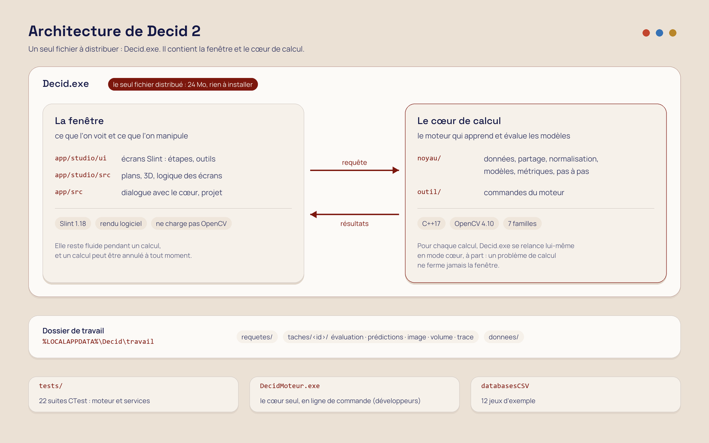

# Decid 2

Nouvelle version de Decid, le logiciel d'apprentissage des classifieurs. Elle est développée à côté de l'ancien
programme (`../src`), qui reste intact.

On charge un jeu de données, on choisit un algorithme, on entraîne, et on voit la frontière de décision se former.
On peut aussi regarder l'intérieur du modèle, comparer des expériences et suivre un apprentissage pas à pas.


- **Guide d'utilisation** illustré : [docs/GUIDE.md](docs/GUIDE.md)
- **Bilan des corrections** par rapport à l'ancien Decid : [docs/BILAN.md](docs/BILAN.md)

## Lancer

`Decid.exe` est un fichier unique : aucune installation, aucune DLL à copier.

- Systèmes : Windows 10 (version 1607 ou plus récente) et Windows 11, en 64 bits.
- Droits administrateur : non nécessaires.
- Carte graphique : non nécessaire. Le rendu se fait par défaut sur le processeur.
- Premier lancement : les jeux d'exemple (des fichiers CSV) sont extraits dans `%LOCALAPPDATA%\Decid`.
- Préférences : elles sont enregistrées dans `%APPDATA%\Decid\preferences.ini`.

L'exécutable n'est pas signé. Au premier lancement, Windows SmartScreen peut afficher « Windows a protégé votre
ordinateur » : il faut cliquer sur « Informations complémentaires », puis sur « Exécuter quand même ».

## Ce que fait Decid 2

| | |
|---|---|
| Données | 12 jeux d'exemple ; import CSV avec contrat de lecture explicite ; import des projets `.cmc` et des bornes `.lim` de l'ancien Decid ; partage apprentissage/test choisi et rejouable (graine) |
| Algorithmes | SVM, k plus proches voisins, forêt aléatoire, Bayes normal, réseau de neurones, boosting, EM |
| Résultats | frontière en dégradé de confiance, matrice de confusion cliquable, réglage en direct (F4), intérieur du modèle (vecteurs de support, gaussiennes), volume 3D |
| Comprendre | « Je découvre » (6 questions : on parie, le moteur calcule, on manipule), bac à sable, pas à pas (AdaBoost, perceptron, k-moyennes, EM, réseau), effet de chaque valeur d'un réglage |
| Outils | validation croisée et balayage de paramètre, régression, génération de jeux, application d'un modèle à un autre fichier, atelier image (segmentation couleur, webcam) |
| Séance | expériences comparables, projet `.decid` (enregistrer, rouvrir), export des résultats publiés par le moteur, thème clair ou sombre, lecture facilitée |

## Compiler

### Prérequis

| Outil | Version | Rôle |
|---|---|---|
| Visual Studio 2022 Community | charge de travail « Développement Desktop en C++ » (CMake inclus) | compilateur |
| OpenCV | 4.10.0 pour Windows (`opencv-4.10.0-windows.exe`, celui de l'ancien Decid) | moteur : SVM, k-PPV, arbres, EM, boosting |
| Slint | 1.18.1 pour C++ (`Slint-cpp-1.18.1-win64-MSVC-AMD64.exe`, sur la page des versions GitHub de slint-ui) | interface |

Emplacements attendus, que l'on peut changer :

- OpenCV : `D:/opencv/build` ; sinon, modifier `OpenCV_DIR` dans `CMakePresets.json`.
- Slint : installé dans `decid2/externe/slint` ; sinon, passer `-DSlint_DIR=<installation>/lib/cmake/Slint`.

Sans Slint, seul le moteur en ligne de commande `DecidMoteur.exe` est construit.

### Dans Visual Studio

1. Ouvrir le dossier `decid2` avec **Fichier > Ouvrir > Dossier**. Visual Studio lit `CMakePresets.json` et configure
   le projet.
2. Choisir le préréglage **Windows x64**, puis la configuration **Release**.
3. Lancer **Générer > Tout générer**. On obtient `build/app/Release/Decid.exe`, avec les
   DLL copiées à côté.
4. Pour les tests, ouvrir l'**Explorateur de tests**, ou lancer `ctest --preset tests` (22 suites).

On peut aussi obtenir une solution `.sln` classique :

```
cmake --preset windows
start build\Decid2.sln
```

### Exécutable portable

`scripts/construire-portable.ps1` produit le `Decid.exe` unique décrit plus haut. Il compile Slint et OpenCV en
bibliothèques statiques, depuis leurs sources officielles, puis embarque les jeux d'exemple. Il faut
aussi Rust (`cargo`) pour compiler Slint. La première construction est longue, car elle compile Slint et OpenCV.

## Organisation



`Decid.exe` contient à la fois la fenêtre et le cœur de calcul. Quand on lance un entraînement, la fenêtre reste
ouverte et démarre en arrière-plan une copie invisible d'elle-même, en mode cœur (`Decid.exe --moteur`). Cette
copie n'ouvre aucune fenêtre : elle calcule, publie ses résultats dans le dossier de travail, puis se ferme. On peut
donc annuler un calcul, et une erreur de calcul ne ferme jamais la fenêtre. La fenêtre, elle, ne charge jamais
OpenCV.

Pour les développeurs, le même cœur existe en ligne de commande : `DecidMoteur.exe` (tests, scripts).

## Méthode

1. **Audit de l'ancien Decid.** Lecture du code, essais sur l'exécutable de référence et mesures. Chaque défaut est
   noté avec sa preuve (fichier et ligne). Le [bilan](docs/BILAN.md) reprend les défauts confirmés.
2. **Moteur réécrit d'abord, avec ses tests.** On a fixé des règles explicites :
   - pas de ligne sautée en silence à l'import ;
   - un partage d'indices enregistré ;
   - une normalisation calculée sur l'apprentissage seul ;
   - des métriques sans NaN.
3. **Choix de l'interface sur mesures.** Trois technologies (Slint, WebView2, Sciter) ont été comparées sur un même
   banc : taille livrée, démarrage, mémoire, images par seconde. Slint a été retenu.
4. **Prototype puis portage.** Le parcours a d'abord été mis au point sur une maquette interactive, puis porté
   écran par écran. Chaque écran a été vérifié sur de vrais calculs du moteur, par des captures automatiques
   (option `--capture` de `Decid.exe`).
5. **Ressources mesurées.** Sur la même machine que l'ancien Decid : taille livrée, démarrage, mémoire et
   processeur au repos. Les chiffres sont dans le bilan.

## Licences des composants

- OpenCV : Apache 2.0.
- Slint : Royalty-free 2.0, interface réalisée avec [Slint](https://slint.dev).
- Polices Manrope et Space Grotesk : SIL Open Font License 1.1.

Ces licences sont aussi rappelées dans la fenêtre « À propos ».

This software is for teaching and testing purpose only.
