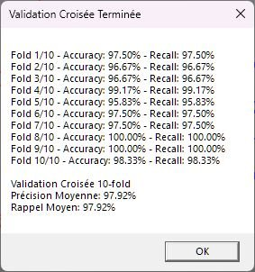
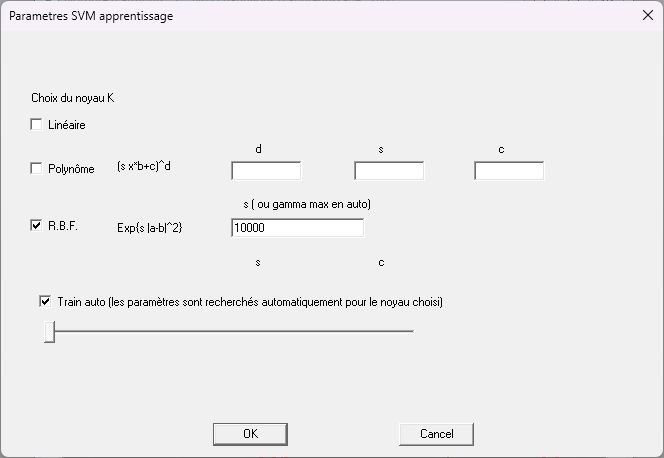
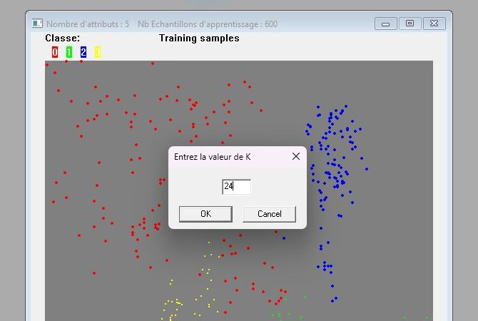

# Bilan des corrections par rapport à l'ancien Decid

Ce bilan part d'un audit de l'ancien Decid (Decid 3D 2025, sources dans `../../src`). Deux sources ont servi :

- la lecture du code ;
- des essais sur l'exécutable de référence.

Chaque défaut ci-dessous a été vérifié à la ligne de code indiquée. La colonne « Vu » indique :

- **R** : le défaut a été reproduit sur l'exécutable.
- **C** : le défaut est établi par le code seul.

Gravité :

- **1** : résultat faux ou perte de données.
- **2** : fiabilité, ou ergonomie bloquante.
- **3** : gêne.

## En bref

- **24 défauts confirmés.** Tous sont traités dans Decid 2, au niveau du moteur ou de l'interface.
- **Les plus graves faussent les résultats sans prévenir :**
  - la première ligne d'un CSV est perdue ;
  - les options de partage sont ignorées ;
  - la normalisation est calculée sur les données de test ;
  - les métriques valent NaN ou sont mal nommées ;
  - EM ramène K à 2 sans le dire.
- **Livraison.** On passe de 62 fichiers et 118 Mo, avec des DLL à installer à la main, à un seul fichier de
  24 Mo.

## 1. Données et import

| # | Gr. | Vu | Défaut | Cause | Correction dans Decid 2 |
|---|---|---|---|---|---|
| 1 | 1 | R | La première observation d'un CSV disparaît à l'import. Un export puis réimport perd une ligne. | L'import saute toujours une ligne : [`DonneeFloatMod.cpp:282`](../../src/DonneeFloatMod.cpp#L282) (`loadFromCSV(..., 1, ...)`). | En-tête déclaré (non, oui ou auto). Si la première ligne est ambiguë, l'import est refusé : [`noyau/Donnees.cpp`](../noyau/Donnees.cpp). Un test vérifie qu'un export puis réimport rend les données bit à bit : [`tests/test_donnees.cpp`](../tests/test_donnees.cpp). |
| 2 | 1 | C | Une erreur d'import n'est pas signalée, et le jeu chargé avant est effacé. | `LireDonneeCSV` vide le jeu ([`:280`](../../src/DonneeFloatMod.cpp#L280)), puis renvoie 0 ou N. L'appelant ne traite que -1 à -6 ([`ChildFrm.cpp:2820`](../../src/ChildFrm.cpp#L2820)). | Erreur avec fichier, ligne et colonne. Le jeu en cours n'est pas touché tant que la lecture n'a pas réussi. |
| 3 | 1 | C | Avec des classes numérotées 1, 2, 3 ou 10, 20, les comptes sont faux, ou le programme plante. | Le label sert d'indice de tableau ([`DonneeFloatMod.cpp:319`](../../src/DonneeFloatMod.cpp#L319)). | Les labels sont convertis en 0..K-1. Les labels fractionnaires, vides ou NaN sont refusés. |
| 4 | 2 | C | Dans un projet CMC, le bouton « 1 / 0 » (tout en apprentissage) donne en fait 75 %. | [`ChildFrm.cpp:469`](../../src/ChildFrm.cpp#L469) (`m_Prop == 3` donne 75). | La proportion est libre et affichée, et l'interface propose de 1/8 à 7/8. Un test vide est signalé. |
| 5 | 3 | C | Ouvrir un CSV crée des fichiers `.cmc`, `.dat` et `.lim` à côté, sans prévenir. | [`DonneeFloatMod.cpp:375`](../../src/DonneeFloatMod.cpp#L375). | L'import ne fait que lire : rien n'est écrit à côté des fichiers source. |

## 2. Partage apprentissage / test

| # | Gr. | Vu | Défaut | Cause | Correction |
|---|---|---|---|---|---|
| 6 | 1 | C | Les cases « first half for training » et « Prop. Inverse » ne changent pas le découpage. | Le ratio standard est réappliqué ([`DonneeFloatMod.cpp:183`](../../src/DonneeFloatMod.cpp#L183)). Pour un CSV, `SplitData` est commenté ([`:324`](../../src/DonneeFloatMod.cpp#L324)). | Les indices d'apprentissage et de test sont explicites et enregistrés avec l'expérience : [`noyau/Partage.cpp`](../noyau/Partage.cpp). |
| 7 | 2 | C | La validation croisée donne un résultat différent à chaque lancement, sans moyen de rejouer le même. | `std::random_device` ([`ChildFrm.cpp:2982`](../../src/ChildFrm.cpp#L2982)). | Les plis sont tirés avec une graine affichée et sont enregistrés : [`noyau/Validation.cpp`](../noyau/Validation.cpp). |

## 3. Normalisation

| # | Gr. | Vu | Défaut | Cause | Correction |
|---|---|---|---|---|---|
| 8 | 1 | C | « Normalise » calcule les bornes avec les données de test, ce qui rend l'évaluation trop optimiste. | Min et max sur toutes les données ([`DonneeFloatMod.cpp:613`](../../src/DonneeFloatMod.cpp#L613)). | Min-max calculé sur l'apprentissage seul, et refait dans chaque pli : [`noyau/Normalisation.cpp`](../noyau/Normalisation.cpp). |
| 9 | 2 | C | Les points de test s'affichent à une autre échelle que ceux d'apprentissage. | Le test est normalisé avec ses propres bornes ([`DonneeFloatMod.cpp:1119`](../../src/DonneeFloatMod.cpp#L1119)). | Une seule normalisation, enregistrée avec le modèle. |

## 4. Métriques

| # | Gr. | Vu | Défaut | Cause | Correction |
|---|---|---|---|---|---|
| 10 | 1 | C | Une prédiction hors bornes fait planter l'évaluation, ou fausse la matrice de confusion. | `v > nbClasses` au lieu de `>=` ([`ChildFrm.cpp:1655`](../../src/ChildFrm.cpp#L1655)), puis `MatConf[..][v]` ([`:1660`](../../src/ChildFrm.cpp#L1660)). | Chaque vérité et chaque prédiction est contrôlée dans [0, K) : [`noyau/Metriques.cpp`](../noyau/Metriques.cpp). |
| 11 | 1 | C | Le rapport affiche « nan » ou « inf » quand une classe est absente du test. | Divisions sans garde ([`ChildFrm.cpp:1666`](../../src/ChildFrm.cpp#L1666)). | Une métrique indéfinie l'est avec sa raison, jamais NaN. |
| 12 | 2 | R | En validation croisée, la « Précision moyenne » est en réalité l'exactitude moyenne. | [`ChildFrm.cpp:3066`](../../src/ChildFrm.cpp#L3066) et [`:3069`](../../src/ChildFrm.cpp#L3069). | Exactitude, précision et rappel sont distingués, avec leur moyenne (macro ou pondérée) nommée. |

*Ancien Decid : l'exactitude et le rappel de chaque pli sont identiques. La « Précision moyenne » de 97,92 % est la
moyenne des exactitudes.*

## 5. Algorithmes

| # | Gr. | Vu | Défaut | Cause | Correction |
|---|---|---|---|---|---|
| 13 | 1 | C | EM : si on annule l'enregistrement du CSV classé, le modèle choisi juste avant est effacé. | Le chemin reste celui du modèle ([`ChildFrm.cpp:4020`](../../src/ChildFrm.cpp#L4020)), puis `std::ofstream` le tronque ([`:4025`](../../src/ChildFrm.cpp#L4025)). | Une seule destination par écriture, écrite dans un fichier temporaire puis renommée. Les fichiers source sont protégés. |
| 14 | 1 | R | EM : « Annuler » dans le choix de K lance quand même l'apprentissage, et K = 24 est ramené à 2 sans le dire. | Le retour de `DoModal` est ignoré ([`ChildFrm.cpp:3882`](../../src/ChildFrm.cpp#L3882)). Ensuite `if (Cluster < 2 \|\| Cluster > 20) Cluster = 2` ([`:3884`](../../src/ChildFrm.cpp#L3884)). | Une valeur hors limites est refusée avec un message, jamais corrigée en silence. |
| 15 | 2 | R | Le SVM automatique dépend d'une borne de γ saisie, sans explication. | La grille de γ va de 0,01 à la valeur saisie ([`ChildFrm.cpp:1367`](../../src/ChildFrm.cpp#L1367)). | Les réglages sont explicites, et l'effet de chaque valeur est montré. Le balayage est tracé (outil Validation). |
| 16 | 2 | C | Un modèle enregistré ne dit pas avec quelles données, quel découpage ni quelle normalisation il a été appris. | `svm->save(pm)` seul ([`ChildFrm.cpp:1486`](../../src/ChildFrm.cpp#L1486)). | Un manifeste accompagne le modèle : empreinte du jeu, du partage et de la normalisation. Il est vérifié quand on réapplique le modèle. |

 

*À gauche, « gamma max en auto » fixe la borne de la recherche. À droite, K = 24 est accepté par la boîte de
dialogue, puis ramené à 2 par le code.*

## 6. Interface et robustesse

| # | Gr. | Vu | Défaut | Cause | Correction |
|---|---|---|---|---|---|
| 17 | 1 | C | Pendant l'apprentissage SVM, la fenêtre ne répond plus et on ne peut pas annuler. Un cœur du processeur tourne à fond pendant l'attente. | Boucle `PeekMessage` sans attente ([`ChildFrm.cpp:1461`](../../src/ChildFrm.cpp#L1461)), thread détaché ([`:1451`](../../src/ChildFrm.cpp#L1451)). | Calcul dans un processus séparé, avec un bouton Annuler. La fenêtre reste utilisable, et un calcul annulé ne publie rien. |
| 18 | 2 | C | Il faut enregistrer le modèle avant de savoir si l'apprentissage réussit. | Boîte d'enregistrement avant l'entraînement ([`ChildFrm.cpp:1396`](../../src/ChildFrm.cpp#L1396), [`:3887`](../../src/ChildFrm.cpp#L3887)). | On entraîne d'abord, puis on enregistre si on veut (projet `.decid`, export). |
| 19 | 2 | C | Il faut fermer la fenêtre 3D avant d'importer des données. | [`ChildFrm.cpp:2760`](../../src/ChildFrm.cpp#L2760). | La vue 3D fait partie des résultats et ne bloque rien. |

## 7. Performances et ressources

| # | Gr. | Vu | Défaut | Cause | Correction |
|---|---|---|---|---|---|
| 20 | 2 | C | Redimensionner ou repeindre la fenêtre relance le calcul de la frontière 2D. | `OnPaint` appelle `VisufrontiereOpencv` ([`ChildFrm.cpp:682`](../../src/ChildFrm.cpp#L682)). | L'image de décision est calculée une fois par le moteur. Ensuite, un redimensionnement ne fait que la remettre à l'échelle, et seulement quand la taille est stable. |
| 21 | 2 | C | La vue 3D est lourde (grille 80³ par défaut, jusqu'à 300³), et sa frontière n'est juste que pour des données dans [0, 1]. | Grille dans [0,1] ([`ChildFrm.cpp:5154`](../../src/ChildFrm.cpp#L5154)) et un verrou à chaque cellule ([`:5161`](../../src/ChildFrm.cpp#L5161)). | Résolution réglable (60 par défaut), domaine propre à chaque axe. Seuls les voxels de la frontière sont dessinés. |

Ressources mesurées sur la même machine, au repos pendant 15 s :

| | Ancien Decid 3D 2025 | Decid 2 |
|---|---|---|
| Livraison | 62 fichiers, 118 Mo | 1 fichier, 24 Mo |
| Ouverture de la fenêtre | 0,2 s (1,6 s au premier lancement) | 0,08 s |
| Mémoire au repos | 28 Mo (9 Mo privés) | 35 Mo (15 Mo privés) ; 40 Mo avec un résultat affiché |
| Processeur au repos | 0 % | 0 % |

D'où vient l'écart de taille :

| | Ancien Decid | Decid 2 |
|---|---|---|
| Visualisation 3D | 43 DLL VTK : 46 Mo | aucune (3D calculée par le code de Decid) |
| OpenCV | `opencv_world4100.dll` : 62 Mo, avec tous les modules (réseaux profonds, vidéo, calibration…) | lié en statique, seulement core, imgproc, ml et imgcodecs, sans IPP : seul le code réellement appelé est gardé |
| Moteur | dans l'exécutable | dans l'exécutable |
| Jeux d'exemple | 4,5 Mo | 5,9 Mo |
| Total | 118 Mo, 62 fichiers | 24 Mo, 1 fichier (interface, Slint, moteur, OpenCV utile et jeux compressés) |

Au premier lancement, seuls les jeux d'exemple (des fichiers CSV) sont extraits dans `%LOCALAPPDATA%\Decid\portable`,
soit 5,9 Mo : l'ensemble occupe environ 30 Mo sur le disque. Aucun programme n'est extrait. Pour calculer,
`Decid.exe` se relance lui-même, sans fenêtre, en mode cœur.

## 8. Distribution

| # | Gr. | Vu | Défaut | Cause | Correction |
|---|---|---|---|---|---|
| 22 | 2 | C | Le projet ne peut pas être recompilé tel quel : des fichiers sources manquent. | `SVMParametres1.cpp/.h` et `TreeConfig.cpp/.h` sont référencés ([`Decid.vcxproj:355`](../../src/Decid.vcxproj#L355)) mais absents. | Le projet CMake est complet et s'ouvre dans Visual Studio 2022. Il compile sans avertissement, et 22 suites de tests accompagnent le code. |
| 23 | 2 | C | L'exécutable ne démarre pas sans DLL OpenCV et VTK, à télécharger et à copier à la main. | [`README.md`](../../README.md) du dépôt. | Exécutable unique : OpenCV, Slint et le runtime C++ sont intégrés. |
| 24 | 3 | C | La configuration et le dossier `datas` sont écrits à côté de l'exécutable, ce qui échoue dans un dossier protégé. | [`ChildFrm.cpp:6247`](../../src/ChildFrm.cpp#L6247). | Préférences dans `%APPDATA%\Decid`, travail dans `%LOCALAPPDATA%\Decid`. |

## Ce que Decid 2 ajoute

- Un parcours guidé Données → Modèle → Résultats, et « Je découvre », pour une première prise en main.
- L'intérieur des modèles : vecteurs de support, gaussiennes de Bayes, et l'effet de chaque valeur d'un réglage,
  calculé réellement par le moteur.
- Le pas à pas d'AdaBoost, du perceptron, des k-moyennes, d'EM et d'un réseau de neurones.
- La comparaison d'expériences : une comparaison n'est dite directe que si les données et les points de test sont
  les mêmes.
- Le réglage en direct, la validation croisée, le balayage de paramètre et la régression.
- L'application d'un modèle à un autre fichier et l'atelier image avec webcam.
- La lecture des projets `.cmc` et des fichiers `.lim` de l'ancien Decid.

## Limites connues

- L'exécutable n'est pas signé : SmartScreen peut demander une confirmation au premier lancement.
- Windows 7 et 8.1 ne sont pas pris en charge (Windows 10 version 1607 au minimum).
- Les défauts marqués **C** sont établis par la lecture du code ; ils n'ont pas tous été reproduits sur
  l'exécutable.
