# Guide d'utilisation de Decid 2

Les numéros sur les captures renvoient aux listes sous chaque image.

- [Premier lancement](#premier-lancement)
- [Tutoriel 1 : une première étude](#tutoriel-1--une-première-étude)
- [Tutoriel 2 : comprendre un réglage](#tutoriel-2--comprendre-un-réglage)
- [Tutoriel 3 : étudier ses propres données](#tutoriel-3--étudier-ses-propres-données)
- [Tutoriel 4 : suivre un apprentissage pas à pas](#tutoriel-4--suivre-un-apprentissage-pas-à-pas)
- [Tutoriel 5 : le bac à sable](#tutoriel-5--le-bac-à-sable)
- [Tutoriel 6 : segmenter une image](#tutoriel-6--segmenter-une-image)
- [Les données en 3D](#les-données-en-3d)
- [Raccourcis et projet](#raccourcis-et-projet)

## Premier lancement

1. **Je découvre** : six questions courtes pour une première prise en main. Pour chacune, on parie sur le
   résultat, le moteur calcule, puis on manipule.
2. **Je mène une étude** : l'espace de travail complet.
3. **Ouvrir un projet** : reprendre une séance enregistrée (fichier `.decid`).
4. **Lecture facilitée** (police et interlignes plus grands, sans animation) et **thème clair ou sombre**. Ces
   choix sont mémorisés.

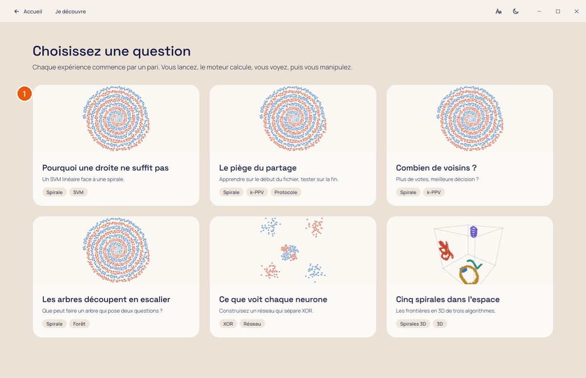

1. Chaque carte pose une question. Par exemple : « Pourquoi une droite ne suffit pas », « Le piège du partage »,
   « Combien de voisins ? ». La vignette montre le jeu utilisé.

## Tutoriel 1 : une première étude

L'étude se déroule en trois étapes, rappelées en bas de la fenêtre : **Données**, **Modèle**, **Résultats**.

### Étape 1 : les données

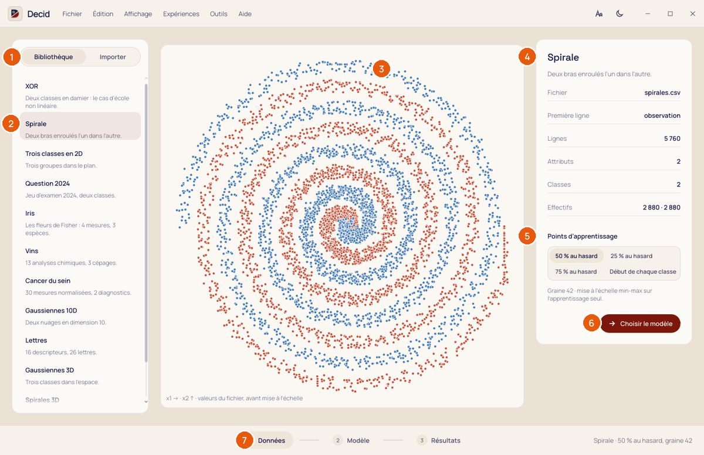

1. **Bibliothèque** ou **Importer** : choisir un jeu fourni ou lire son propre fichier.
2. La liste des jeux fournis. Ici, on choisit **Spirale** : deux bras enroulés l'un dans l'autre.
3. Les points du fichier, tels qu'ils sont, avant toute mise à l'échelle.
4. La fiche du jeu : fichier, nombre de lignes, d'attributs et de classes, effectifs par classe.
5. **Points d'apprentissage** : la part des données qui sert à apprendre. Le reste sert à tester. Le tirage est
   fait avec une graine (42), il est donc rejouable.
6. **Choisir le modèle** : passer à l'étape suivante.
7. Les trois étapes : on peut revenir en arrière à tout moment.

### Étape 2 : le modèle

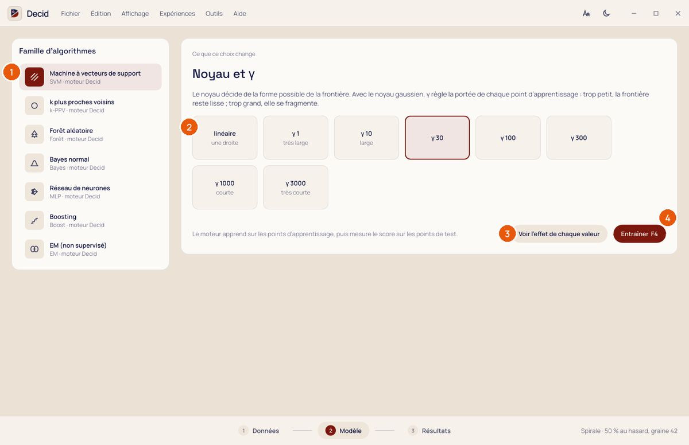

1. La **famille d'algorithmes** : SVM, k plus proches voisins, forêt aléatoire, Bayes normal, réseau de neurones,
   boosting, EM.
2. Le **réglage principal** de la famille, avec ce que chaque valeur change. Pour le SVM à noyau gaussien, γ règle
   la portée de chaque point d'apprentissage.
3. **Voir l'effet de chaque valeur** : le moteur calcule une frontière par valeur (voir le tutoriel 2).
4. **Entraîner** (touche F4). Pendant le calcul, un bandeau indique la phase en cours et propose **Annuler**.

### Étape 3 : les résultats

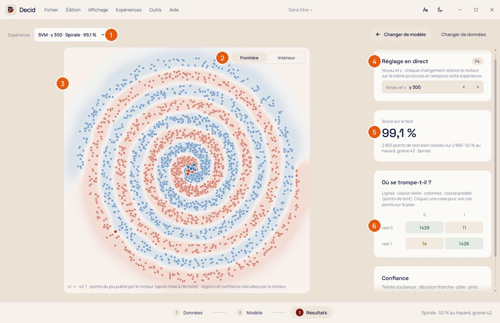

1. L'**expérience** affichée. Chaque entraînement en ajoute une, qu'on peut rouvrir et comparer (menu
   Expériences).
2. **Frontière** ou **Intérieur** du modèle.
3. La frontière de décision. La couleur est d'autant plus soutenue que le modèle est sûr de lui. Les points sont
   ceux du test ; les erreurs sont dessinées devant.
4. **Réglage en direct** : changer la valeur relance le moteur sur le même protocole et remplace l'expérience.
5. Le **score sur le test** : la part des points de test bien classés.
6. **Où se trompe-t-il ?** : la matrice de confusion (lignes : classe réelle ; colonnes : classe prédite). Cliquer
   sur une case montre ces points sur le plan.

## Tutoriel 2 : comprendre un réglage

Dans l'étape Modèle, **Voir l'effet de chaque valeur** fait calculer par le moteur une frontière pour chaque
valeur du réglage, sur le même jeu et avec le même partage.

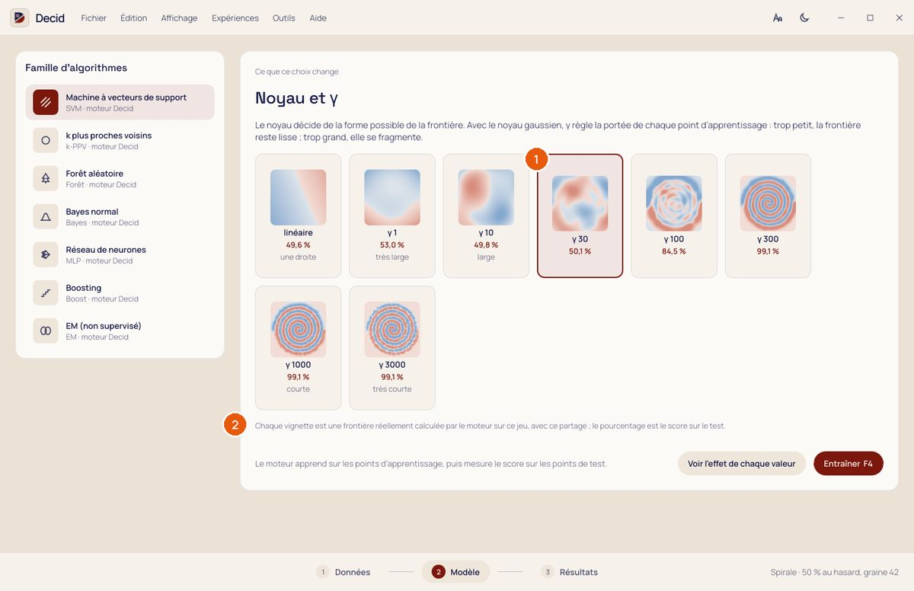

1. Chaque vignette est une vraie frontière, avec son score sur le test. Sur la spirale, avec un γ trop petit, la
   frontière reste presque droite (50 %). Avec un γ assez grand, elle suit les bras (99 %).
2. Les scores viennent du moteur, pas d'une illustration.

Une fois le modèle entraîné, **Intérieur** montre ce que le modèle a retenu :

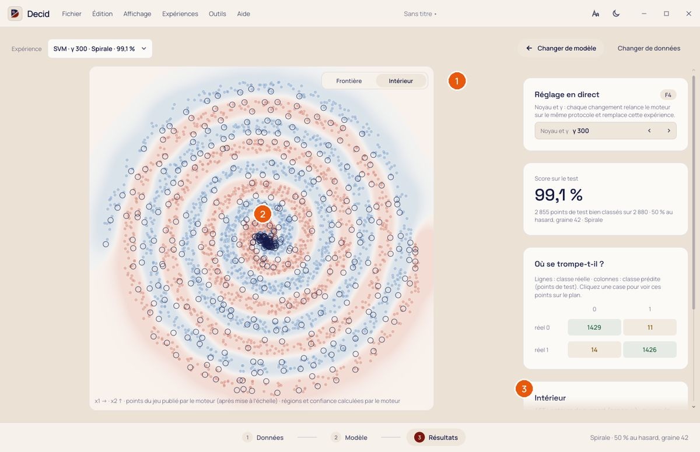

1. La bascule **Frontière / Intérieur**.
2. Pour un SVM, les **vecteurs de support** sont entourés : eux seuls définissent la frontière. Pour Bayes normal,
   ce sont les gaussiennes de chaque classe.
3. L'explication de ce qui est affiché.

## Tutoriel 3 : étudier ses propres données

Le fichier attendu est un CSV avec une colonne de classe et une ou plusieurs colonnes d'attributs. Les projets
`.cmc` de l'ancien Decid sont aussi acceptés.

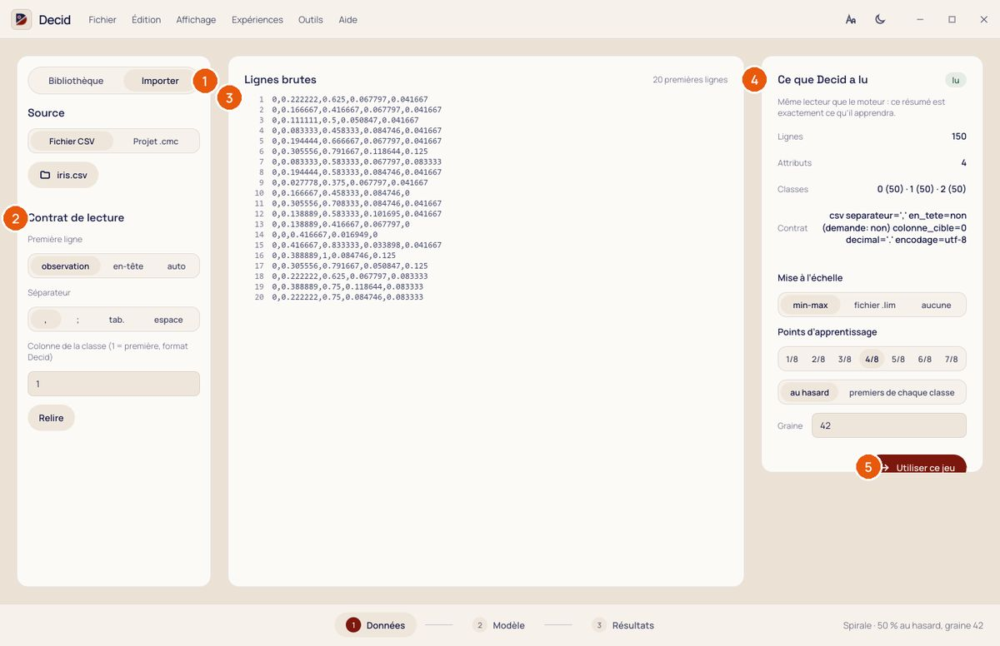

1. Onglet **Importer**, puis choisir le fichier (CSV ou projet `.cmc`).
2. Le **contrat de lecture** :
   - la première ligne est-elle un en-tête ?
   - quel est le séparateur ?
   - quelle colonne contient la classe ?

   Rien n'est deviné en silence : si la première ligne est ambiguë, Decid le dit.
3. Les **lignes brutes** du fichier, pour vérifier.
4. **Ce que Decid a lu** : lignes, attributs, classes et effectifs, avec le même lecteur que le moteur.
   Viennent ensuite :
   - la mise à l'échelle : min-max, bornes d'un fichier `.lim`, ou aucune ;
   - la part d'apprentissage et la graine.
5. **Utiliser ce jeu** : il remplace le jeu de la bibliothèque dans l'étude.

## Tutoriel 4 : suivre un apprentissage pas à pas

Menu **Outils > Pas à pas** (ou F5). Disponible pour AdaBoost, le perceptron, les k-moyennes, EM et le réseau de
neurones.

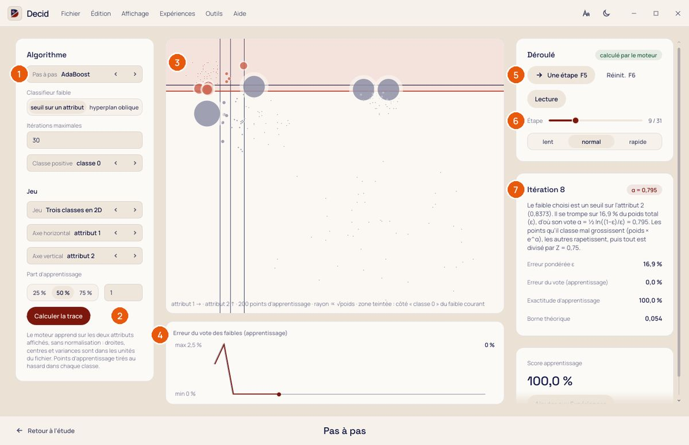

1. L'**algorithme** et ses réglages, puis le jeu et les deux attributs affichés.
2. **Calculer la trace** : le moteur enregistre chaque étape de l'apprentissage.
3. Le plan à l'étape courante. Pour AdaBoost, le rayon d'un point suit son poids : les points mal classés
   grossissent.
4. L'évolution de l'erreur au fil des étapes.
5. **Une étape** (F5), **Réinitialiser** (F6), **Lecture** automatique.
6. Le curseur pour aller directement à une étape, et la vitesse de lecture.
7. Ce qui vient de changer à cette étape, avec les valeurs calculées par le moteur (pour AdaBoost : l'erreur
   pondérée ε et le vote α du classifieur faible).

## Tutoriel 5 : le bac à sable

Menu **Outils > Bac à sable**. On pose soi-même les points, et le modèle réapprend aussitôt.

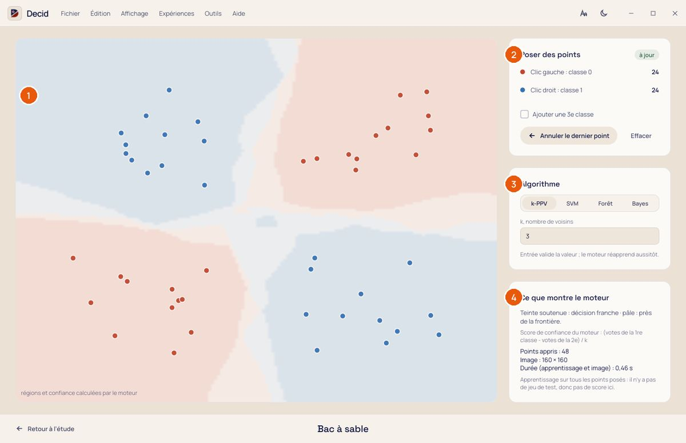

1. Le plan :
   - clic gauche : un point de la classe 0 ;
   - clic droit : un point de la classe 1 ;
   - Ctrl+Z : annuler le dernier point.
2. **Poser des points** : le nombre de points par classe, et l'option d'une troisième classe.
3. L'**algorithme** et son réglage.
4. **Ce que montre le moteur** : la lecture de la frontière et le temps de calcul.

## Tutoriel 6 : segmenter une image

Menu **Outils > Atelier image**. On apprend les couleurs de quelques zones, puis on classe tous les pixels.

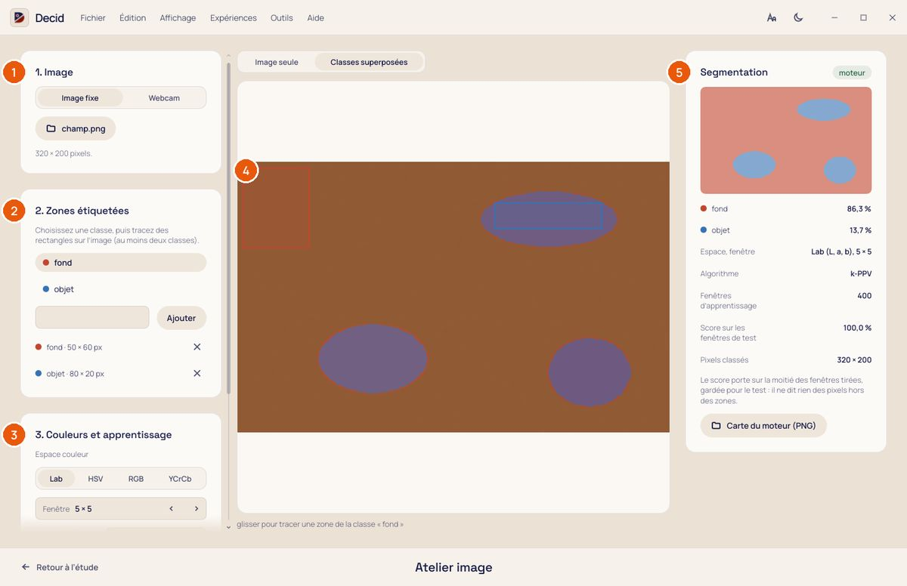

1. **Image** : un fichier PNG ou JPEG, ou la **webcam** (Capturer fige une image). La caméra s'éteint quand on
   quitte l'atelier.
2. **Zones étiquetées** : choisir une classe, puis tracer un rectangle sur l'image. Il faut au moins deux classes.
3. **Couleurs et apprentissage** :
   - l'espace couleur : Lab, HSV, RGB ou YCrCb ;
   - la taille de la fenêtre autour de chaque pixel ;
   - l'algorithme.
4. L'image avec ses zones. On peut afficher par-dessus les classes calculées.
5. **Segmentation** : la carte des classes calculée par le moteur, et la part de chaque classe.

## Les données en 3D

Avec trois attributs ou plus, l'étape Résultats propose un **volume 3D**.

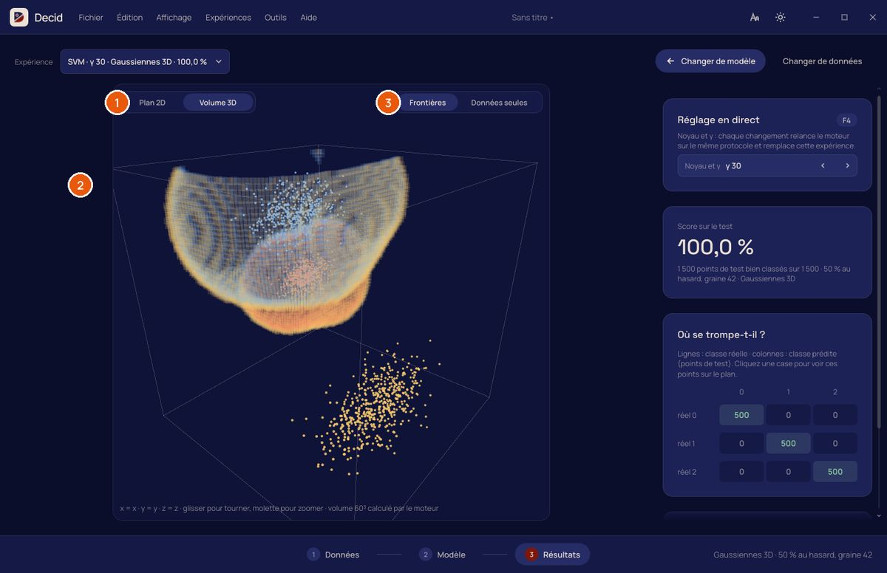

1. **Plan 2D** ou **Volume 3D**.
2. Le volume :
   - glisser pour tourner ;
   - molette pour zoomer.

   Seuls les voxels à la frontière entre deux classes sont dessinés, et leur opacité suit la confiance.
3. **Frontières** ou **Données seules**.

La résolution de la grille, la transparence et la rotation automatique se règlent dans **Affichage >
Préférences**.

## Raccourcis et projet

| Touche | Action |
|---|---|
| F1 | Rafraîchir l'affichage |
| F2 | Plein écran |
| F3 | Importer un CSV |
| F4 | Entraîner le modèle choisi |
| F5 / F6 | Pas à pas : une étape / réinitialiser |
| Ctrl+N, Ctrl+O | Nouveau projet, ouvrir un projet |
| Ctrl+S, Ctrl+Maj+S | Enregistrer, enregistrer sous |
| Ctrl+Z | Annuler le dernier point (bac à sable) |
| Échap | Fermer le dialogue ou le menu ouvert |

Un **projet** (`.decid`) contient le jeu, le partage, les réglages et les expériences de la séance. À la
réouverture, les résultats sont relus. Le titre de la fenêtre signale un projet modifié, et Decid demande
confirmation avant de perdre des modifications. Le **Guide de TP** (menu Aide) propose le
déroulé d'une séance en cinq étapes.

**Fichier > Exporter les résultats** enregistre les fichiers publiés par le moteur pour une expérience : évaluation,
prédictions, image de décision, volume 3D. On y trouve aussi le tableau des expériences en CSV, pour un compte
rendu.
